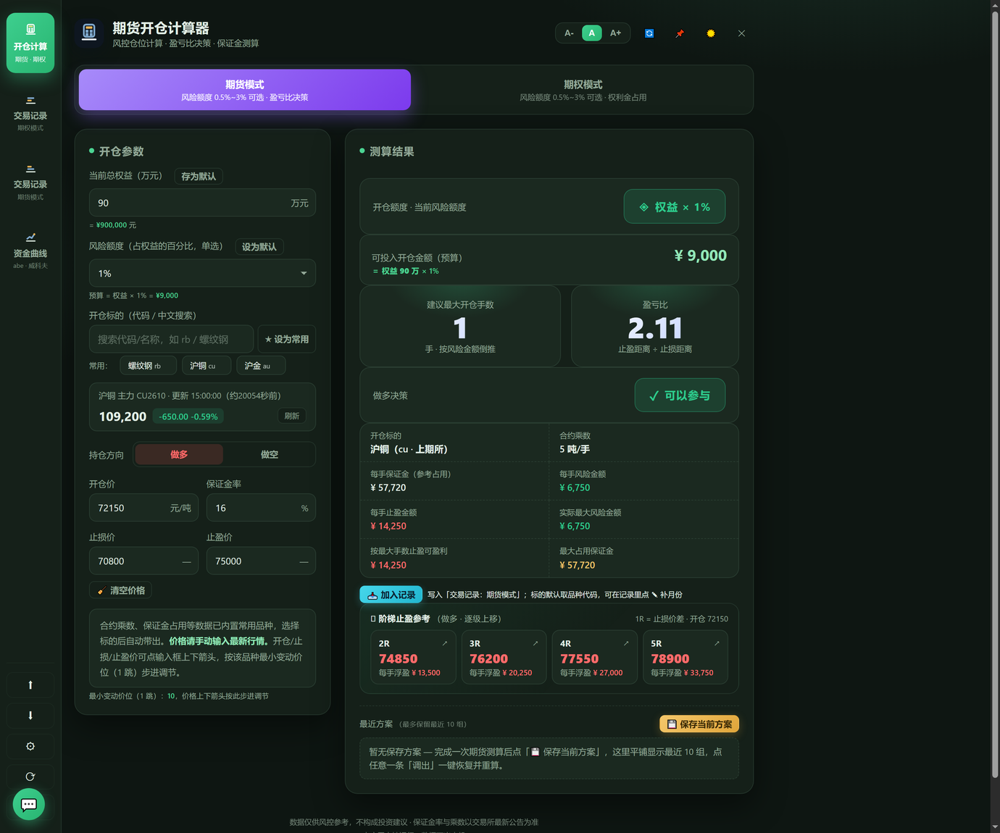
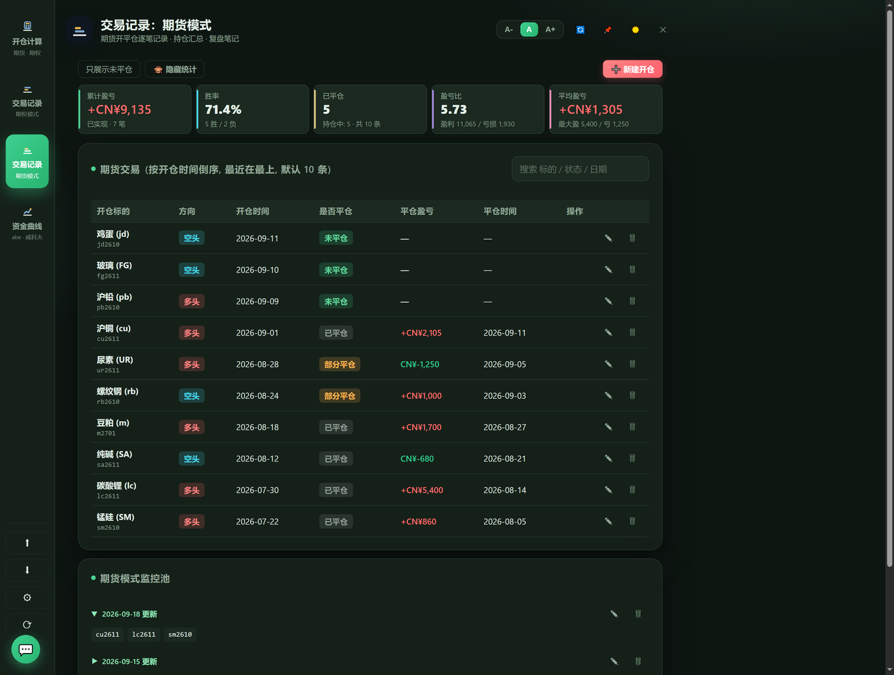
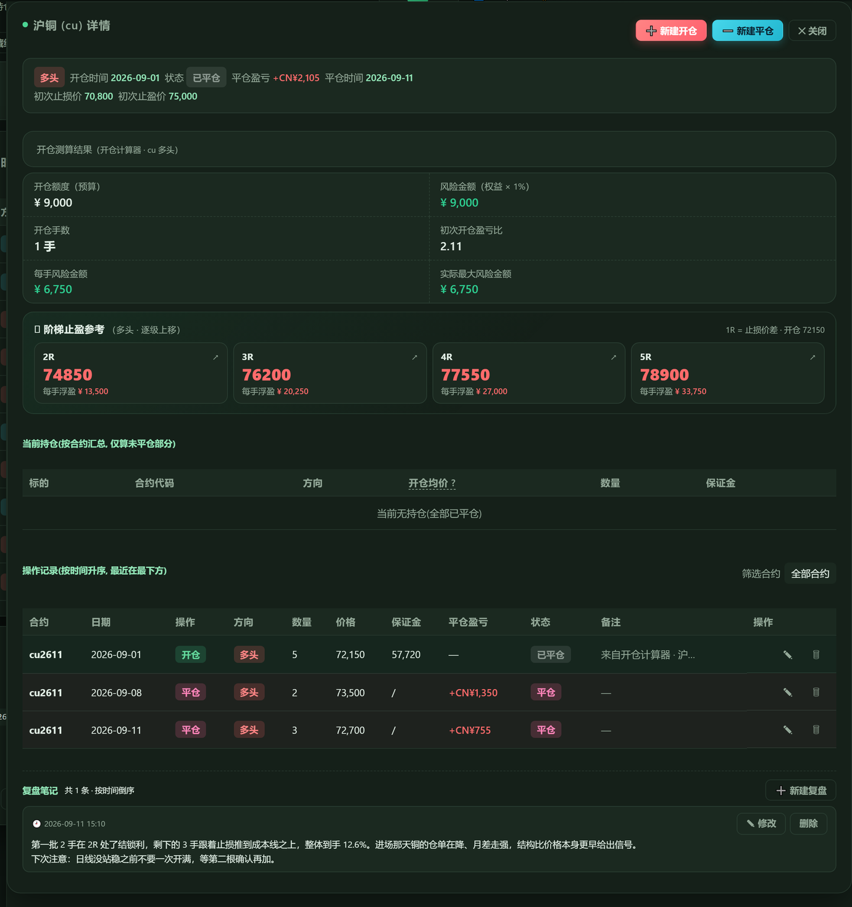
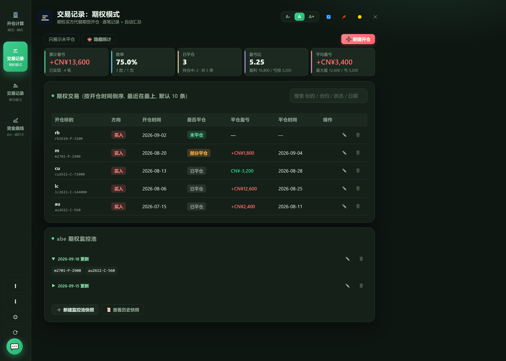
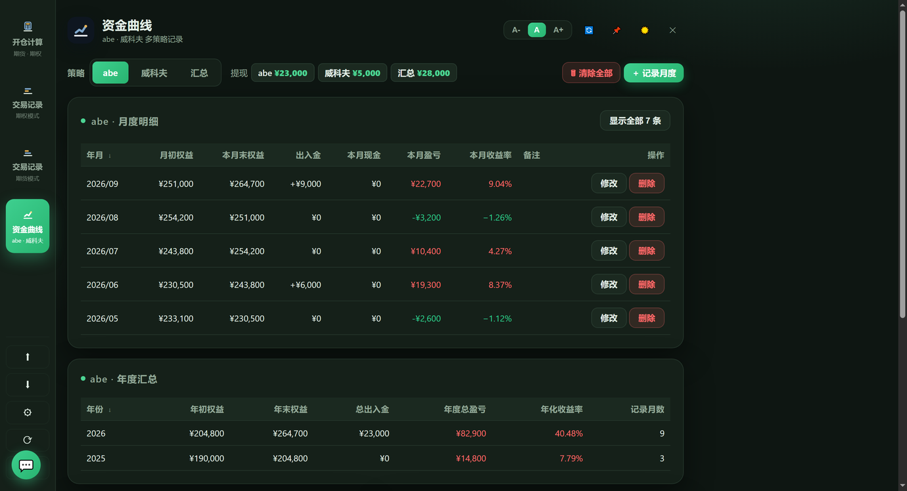
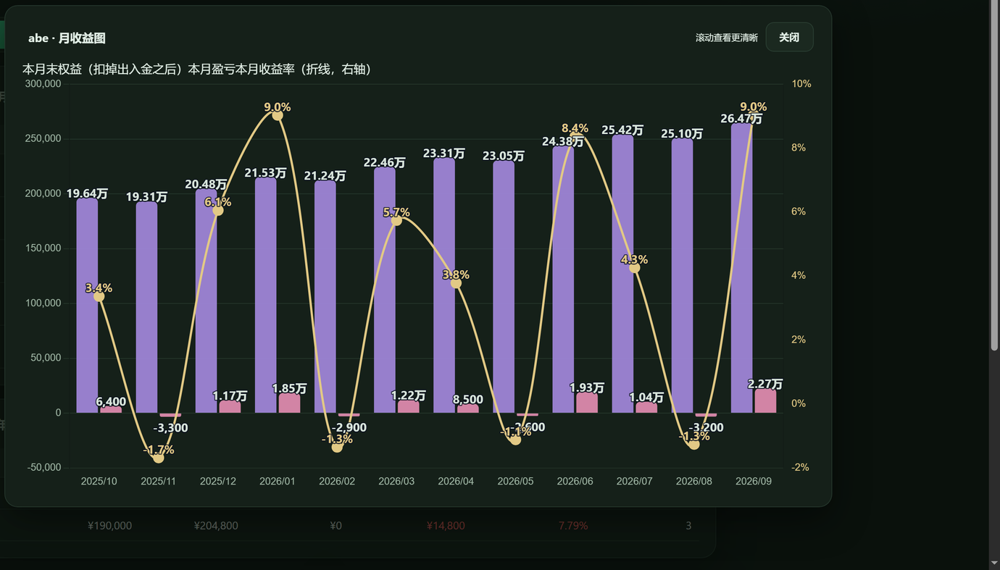

# 期货开仓计算器 (OpenCalc)

本地运行的**期货 / 期权买方 / 期权双买开仓风控 · 交易记录 · 资金曲线**工具。零第三方依赖、双击即用，数据只存本机，不经过任何服务器。

## ✨ 主要功能

### 🧮 开仓计算器



- 三个模式：**期货** / **期权买方** / **期权双买**，参数各自独立、各自记忆（三个模式排成一行）
- 结果区按模式隔离：切到别的模式立刻清空，切回上次算过的模式自动恢复它自己的结果
- 风险额度 0.5% / 1% / 1.5% / 2% / 3%（默认期货 1%、期权 3%），可设为默认
- 期货手数 = 开仓预算 ÷ 每手风险（止损价差 × 乘数）；保证金只作参考展示
- 期权买方：权利金全额占用、不占保证金；开仓价 = 1 手价格（已含乘数）
- 🆕 **期权双买**：call + put 两条腿，输入**期权价格**（行情里的单吨/单点报价，与每手权利金自动换算）+ **当前 IV / IV 百分位**（留档供复盘），
  手数按 **delta 中性**配比（call手数 × |call delta| = put手数 × |put delta|），合计权利金不超预算；
  止盈目标价按**同一价格口径**给出总价值涨到 **2 / 3 / 4 / 5 倍权利金**时两腿各自的价位（涨看 call 腿、跌看 put 腿）
  - put 的 delta 一边输就自动带「-」；delta 统一保留 **4 位小数**
  - 🎨 Call（看涨）**红** / Put（看跌）**青**：两腿参数各是一张带色卡片，结果里的手数卡、止盈目标价位表两列也都按腿上色，不容易看串
- 盈亏比决策：止盈距离 ÷ 止损距离，低于 1.5 提示不参与；手数不足 1 手直接判「不开仓」
- 🪜 **阶梯止盈参考**：以止损价差为 1R，给出 2R~5R 逐级止盈价（按最小变动价位取整，挂单可直接成交）与每档浮盈
- 内置 **75 个品种**的合约乘数 + 最小变动价位；价格按 1 跳步进并校验整数倍
- 最近方案：三个模式**各存最近 10 组**，一键调出重算；参数按**原始输入**留档（不做四舍五入，delta 的 4 位小数原样保留）；卡片右侧 ✕ 可单条删除（删除前二次确认）
- 📥 **加入记录**：把当前参数 + 测算结果一键写入交易记录，并直接跳转到那条记录（不弹提示框）；期货模式上方填了**合约年月**（如 2610），写入的合约与标的都带年月（`rb2610`）
- 🔄 **换品种自动清空**：切到别的标的时该模式的开仓参数与测算结果一起归零，避免拿旧品种的行权价 / 权利金当成新品种的参数；同品种重选不会误清

### 📋 交易记录（期权买方 / 期权双买 / 期货 三个入口，数据互相隔离）



- 主表按**「标的 + 批次」**聚合，同品种多次开仓各自成一条：方向 / 开仓时间 / 是否平仓 / 平仓盈亏 / 平仓时间；默认显示 10 条，可展开全部
  - 期权双买的开仓标的会带上**合约年月**（如 `lc 2611`），下方便是两条腿的完整合约
  - 双买记录的「价格」= **期权价格**（与行情报价、止盈目标价同一口径），「权利金」= **每手金额**（期权价格 × 合约乘数），两者别混
- 期权模式（期权买方 / 期权双买）新建开仓时，**权利金自动 = 开仓价 × 合约乘数 × 数量**（下面小字写明算式），也可以手改；期货模式该字段是保证金，不自动算
- **顶部战绩卡**：累计盈亏 / 胜率 / 已平仓（附持仓中）/ **盈亏比 · 净盈亏比** / 平均盈亏 —— 口径是主表每条记录（一条 = 一笔），可一键隐藏并记住选择
- **手续费与净盈亏**：工具栏可切「交易所 + 0.01」/「不计算」（两个选项直接平铺，不用展开下拉框）；主表有**净盈亏**列（= 平仓盈亏 − 手续费），详情的操作记录里逐笔显示手续费。**平今 / 平昨按开平仓时间自动判，也可以在平仓时手动指定**（自动 / 平今 / 平昨 三选一）—— 有些品种这两档费率差很多（如棉花平今 0、平昨 4.3 元/手）
- **平仓盈亏自动算**（填平仓价就出来，不含手续费）：=(平仓价 − 开仓均价) × 方向 × 合约乘数 × 平仓手数；仍然可以手改，手改的值不会被覆盖（只有再动平仓价 / 平仓数量 / 合约时才重算）；提示行会写明完整算式让你对着核
- 搜索框：匹配 标的 / 合约 / 方向 / 状态 / 日期 / 盈亏，多个关键词空格分隔 = 全部命中
- 右侧详情：**顶部给出这一批的「手续费合计 / 净盈亏」**；持仓汇总（只算未平仓部分的加权均价）+ 操作记录（备注、合约筛选、修改、删除），FIFO 扣减
  - **点合约代码即可复制**（持仓汇总与操作记录里都能点，复制成功底部有提示）
- 平仓数量超额即时拦截；每条记录的详情内容（状态、盈亏、操作、复盘）**完全独立**，不与其他记录掺和
- 期货模式专属：初次止损 / 止盈、开仓测算结果卡、阶梯止盈方块；双买记录里一次操作写入两条腿（同批次归为一条记录）
  - 双买模式在主表点「➕ 新建开仓」会打开**两腿专用弹窗**（一次填 call / put 的行权价·delta·期权价格·手数 + IV / IV 百分位，权利金按开仓价自动算）；
    详情面板里的「新建开仓」仍是**单腿**录入（加仓/补录用）
- **复盘笔记**：三个模式都有，归属跟着「这条记录」走（同品种别的记录看不到）
- 期权记录在详情顶部显示**开仓时的 IV / IV 百分位**（编辑开仓不会被抹掉）
- 双买记录的详情里，「当前持仓」上方有**止盈价测算**：按持仓总权利金给出 2 / 3 / 4 / 5 倍时两腿各自的期权价格目标（涨到 Call 目标平 call、跌到 Put 目标平 put）；Call 列**红**、Put 列**青**一眼分清，从计算器加入的和手动新建的都一样现算，平仓后按剩余持仓自动更新
- 监控池快照（期货 / 期权买方分开保存，保留历史可查）；**期权双买不设监控池**

点开任意一条记录，右侧浮出**这一条自己的**详情 —— 状态 / 持仓 / 操作记录 / 测算结果 / 复盘互不干扰：



期权买方 / 期权双买入口是一套同样的界面，标的为期权合约（如 `lc2611-C-144000`）：



### 📈 资金曲线



- 月度明细 / 年度汇总；月盈亏 = 月末权益 − 月初权益 + 出入金（出金为正）
- 三策略（**期权买方** / 威科夫 / **期权双买**）+ 汇总视图（缺失月份用最近月末延续）
- 累计提现卡片（三个策略 + 汇总）、图表可点击放大（⤢ 放大后数据点多时**下方有左右滑动条**）
- 点图表**图例**可以显示 / 隐藏对应的柱或折线（藏起来的会置灰划线，两根柱都藏了左边轴也跟着收起；缩略图和放大图共用同一个选择）
- 数据变动自动备份（保留最近 10 份）+ 一键恢复到某个时刻

图表点「⤢ 放大」可以铺满屏幕看细节：



### 🧰 通用
- 深色 / 浅色主题；界面字号 小 / 中 / 大（全站跟随）
- 窗口置顶；默认占屏幕左半屏
- 备份导出 / 导入（`.opcalc`）跨电脑迁移；数据目录可自定义，落在软件目录内会亮红点并支持一键迁出
- ⟳ 检查更新：启动静默检查，有新版本亮红点，可选下载 / 备份当前版本

## 🚀 快速开始

**直接运行（推荐）**：下载 `dist/OpenCalc.exe` 双击即可（Windows 10/11，无需任何环境）。

**源码运行**（需 Python 3.8+，仅标准库）：

```bash
python main.py
```

**自己打包 exe**：

```bash
pip install pyinstaller
pyinstaller --onefile --windowed --name OpenCalc --icon icon.ico \
  --add-data "icon.ico;." --add-data "chart.min.js;." \
  --add-data "assets/qrcode-wechat.png;assets" --add-data "assets/qrcode-alipay.png;assets" \
  main.py
```

## 📁 数据存储

数据目录查找顺序（前面的优先）：`OC_DATA_DIR` 环境变量 → 配置里的 `data_dir` → 默认 `%APPDATA%\OpenCalc\data`。

| 内容 | 路径 |
|---|---|
| 资金曲线 + 三种模式的交易记录 + 监控池 + 复盘（主库） | `<数据目录>\funds.db` |
| 自动备份快照（最近 10 份） | `<数据目录>\backup\funds_<时间戳>.db` |
| 用户设置（默认权益 / 风险额度 / 常用标的） | `%APPDATA%\OpenCalc\config.json` |
| 计算器「最近方案」 | 浏览器 localStorage（随 `.opcalc` 一起打包） |

> ⚠️ **建议把数据目录设在软件目录之外**（如网盘同步文件夹）。放在软件自己的文件夹里，更新软件时会跟着被删 —— 启动检测到会亮红点提醒并提供一键迁出。

| | `.db` 自动备份 | `.opcalc` 手动导出 |
|---|---|---|
| 产生方式 | 每次增删改自动存 | 点「⬆ 导出」生成 |
| 用途 | 本机退回某个时刻 | 换电脑 / 长期存档 |
| 恢复方式 | 「⚙ 数据位置」→ 备份列表 → 恢复 | 侧栏「⬇ 导入备份」 |
| 内容 | 整库 | 资金曲线 + 三种模式交易记录 + 监控池 + 复盘 + 最近方案 |

> 备份完整性有专门的往返验证脚本：`python tools/backup_roundtrip.py`（起两个临时库，导出→导入→逐表核对，不碰真实数据）。

## 🧪 测试

```bash
python tests.py                    # 后端自动化测试（跑在临时库上，不碰真实数据）
node oc_cdp_test.js                # 前端 UI 全流程回归（需用 OC_DATA_DIR 指向测试目录启动服务，脚本会自检）
python tools/backup_roundtrip.py   # 备份往返验证（两个临时库，导出→导入→逐表核对）
```

> 想重新生成上面那几张功能截图：见 [`tools/README.md`](tools/README.md)（用临时库 + 演示数据，不碰真实记录）。

## 🔄 发版（维护者）

「检查更新」读的是仓库 `main` 分支的 `version.json`，发版三步：

1. 改 `main.py` 的 `APP_VERSION`（整数，比用户本机大才会提示更新）
2. 更新 `version.json`：`version` / `version_name` / `date` / `url` / `sha256` / `notes`
   - `sha256` 留空则不校验；填了必须完全匹配（重新打包后要重算）
   - `url` 填相对路径时按 `https://raw.githubusercontent.com/zxcools/OpenCalc/main/` 拼接
3. 打包并把 `dist/OpenCalc.exe` 一起提交推送 —— **`version.json` 与 exe 必须同时是最新的**

## ⚠️ 免责声明

本工具仅供个人风控参考，不构成任何投资建议。保证金率、合约乘数以交易所最新公告为准。

## 💬 联系作者

- 知乎：[假装很稳定](https://www.zhihu.com/people/zhang-xu-11-6-63)
- 软件左下角 💬 按钮内有支持方式（微信 / 支付宝）

---

## 📦 更新日志

> 按天记录，一天内的多次改动合并为一条。

### 2026-10-13（v50.79）
- 🆕 **开仓时也算手续费，并把金额直接写出来**：新建开仓弹窗里填了开仓价 / 数量，下面小字立刻给出「**开仓手续费：¥21.55（5 手合计，¥4.31/手）**」—— 平仓弹窗早就能看到平今 / 平昨差多少钱，开仓这一侧以前是空白的
  - 和明细口径完全一致：金额由后端按同一套费率规则算（比例费率的品种按 价格 × 乘数 × 手数），费率表没收录的品种会说明「按 ¥0 计」，不假装免费
- 🆕 **详情页顶部补上整批的「手续费合计 / 净盈亏」**：以前详情只在操作记录里逐笔显示手续费，没有合计。现在标题下方一行直接给出**手续费合计**（开仓 + 平仓两笔之和）与**净盈亏**（= 平仓盈亏 − 手续费）
  - 还没平完的记录按「已发生的那部分」算，并注明；鼠标悬停有口径说明
  - 手续费口径切到「不计算」时这一行自动不显示
- 🆕 **点合约代码即复制**：详情页的**持仓汇总**与**操作记录**里，合约代码可以点，点一下复制到剪贴板，底部弹出「已复制：cf2701」提示 —— 不用再手动选中，省掉复制到券商 App / 搜索框时选错字符的麻烦

### 2026-10-13（v50.78）
- 🆕 **平仓弹窗直接把「平今 / 平昨」两档手续费金额摆出来**：以前只能选档位、看不到差多少钱；现在选之前就知道（如「手续费：平今 ¥0.02 / 平昨 ¥8.62」），当前选中的那一档会高亮。费率一律由后端按同一套逻辑算，不会出现「弹窗说的和主表/详情页对不上」
  - 该品种两档同价时只显示一个数并注明「平今与平昨同价」；费率表没收录的品种会说「按 ¥0 计」，不假装是 0
- 🆕 **未平仓头寸风险汇总**：交易记录页统计卡下面多了一行 —— **未平仓几笔、共几手、占用多少钱、理论最大亏损多少**
  - 期权买方 / 双买：占用 = 剩余权利金；最大亏损 = 权利金（买方最多亏光权利金）
  - 期货：占用 = 保证金（开仓均价 × 乘数 × 手数 × 保证金率，保证金率取当年测算时记录的那个、取不到按 16%）；最大亏损 = 各仓 |开仓均价 − 初始止损| × 乘数 × 手数
  - **没设初始止损的手数会被单列**，并提示「理论最大亏损只是下限，实际可能更大」——不会把没止损的仓位当成零风险
  - 鼠标悬停看逐笔明细（标的 / 合约 / 手数 / 占用 / 最大亏损，按占用资金从大到小）
- 🆕 **恢复备份前先看差异**：点「恢复」时会先列出这份备份与现在的差别（「交易记录：备份 17 条 / 现在 18 条（少 1 条）」+ 备份里的资金曲线与交易开仓日跨度），再让你确认 —— 恢复前就知道会退回掉什么
  - 差异读不出来（备份损坏等）不会挡住恢复，只在确认框里多一句说明

### 2026-10-13（v50.77）
- 🛠 **本轮以修复为主**（按代码审查结果逐条处理），另加了下面的交易日历
- 📅 **接入最小交易日历**：夜盘（21:00 后）属于**下一个交易日**，以前只做「+1 天」—— 周五 21:30 开的仓被算成**周六**，跟「下周一早盘平」判成两个交易日 → **平今被误判成平昨**，手续费多收。现在会跳到**下一个真正的交易日**（跳周六周日 + 跳法定节假日，含春节连休 9 天这类长假）
  - 顺带修：周五夜盘跨到周六凌晨（01:00）也顺延到下周一
  - 日历只维护「交易日 = 周一~周五 且 非法定节假日」；调休补班的周六周日期货市场不开市，所以不按「上班日」算。**表里没有的年份会自动退化成「只跳周末」**（不报错）
  - 节假日表每年要更新一次（国务院办公厅每年 11 月前后发布次年安排）
- 🔧 **备份导入 / 切换数据目录不再静默丢数据**：以前单条记录写库失败会被直接跳过、界面仍提示「导入成功 N 条」→ 少了几条根本查不出来。现在会明确告诉你**成功几条、失败几条**，并列出前几条的原因（如「交易记录 第 3 条：缺少必填字段」）
- 🔧 **「持仓中」不再恒为 0**：统计区间选「按平仓时间」时，未平仓记录因为没有平仓日会被整条滤掉，导致「持仓中」一直显示 0（跟旁边「未平仓不计入」的说明自相矛盾）。现在**持仓数始终按全部记录算**，卡片小字会写明口径（「持仓中 1（全部） · 区间内 3 条」）
- 🔧 **文件夹浏览器的目录名做了转义**：目录名原来直接拼进 HTML 属性，名字里带 `&` 之类的字符会渲染错（本机 Windows 文件名的非法字符限制了实际影响，但代码该转义就要转义）
- 🔧 **其余清理**：备份列表的只读连接在异常路径下会泄漏（补 `finally`）；备份的「上次备份时间 / 待写入说明」在多线程下没加锁（现在加锁，避免重复备份或丢掉变更说明）；导入时开/平仓时间统一截成 `HH:MM`（与手动录入同口径）；「清除全部」改名为**「清除资金曲线」**，确认框不再说「所有数据将被永久删除」（实际只清资金曲线，交易记录 / 监控池 / 复盘都不动）；控制台提示的自动退出时长与实际一致（2 小时）

### 2026-10-12（v50.74 ~ v50.76）
- 📅 **盈亏统计可以选时间范围了**：交易记录三个模式的主表上方多了一行「统计区间」—— **近一月 / 近三月 / 近一年 / 今年以来 / 全部**，选定后**统计卡与下方主表一起收窄**到这段时间内的记录，并显示区间内的条数
  - **口径可切**：按 **开仓时间** 还是 **最后一笔平仓时间** 判断记录是否落在区间内。两者在跨期单子上结果不同（去年开仓、最近才平的，按开仓时间不算近一月，按平仓时间算）；按平仓时间时**未平仓记录不计入**，界面上会写明
  - 区间说明就写在工具条右边，形如「当前：近三月（2026-07-12 起 · 按平仓时间） · 区间内 3 条」，不用猜边界算到哪天
  - 统计卡会跟着区间重算（累计盈亏 / 胜率 / 已平仓 / 盈亏比 / 平均盈亏都是区间内的），卡片 tooltip 里也标着当前是什么区间
  - 区间与已有的「只展示未平仓」「搜索」叠加生效：先按区间收窄，再按那两项过滤
  - 选择会记住（换模式、重开软件都在），并随 `.opcalc` 备份一起走，换电脑不丢
  - 「🙈 隐藏统计与区间」可以连同统计卡把这一行一起收起（偏好一样会记住）
- 🏷 **备份记录会写明「最后的变更内容」**：数据位置弹窗里的备份列表，每份快照下面都标着它是在哪次变动之后存的 —— 如「交易记录-保存 · 期货 · i i2701 · 开仓卖 6 手」「资金曲线-保存：威科夫 2026年10月」「监控池-保存：期权买方 · 3 个合约」。恢复前先看一眼就知道会退回到哪一步
  - **恢复确认框也会念出来**：会显示备份时间、「最后变更」和内含条数（资金 / 交易各多少条），不用靠文件名猜
  - 老备份没有这项信息，会显示「无变更说明（旧备份）」，恢复照旧可用
  - 同一时间窗口内连着改了好几次，这些原因会**合并写进同一份说明**（不会只留最后一次，也不会重复罗列）
  - 说明存在备份文件之外的一个小 sidecar 里，**不进库**；轮转删除旧备份时会连说明一起清掉，不留垃圾文件
- ✋ **新建平仓可以手选「平今 / 平昨」**（三个模式都有）：平仓弹窗里多了一个 **自动 / 平今 / 平昨** 三段选择
  - **自动**（默认）：还是按原来的规则 —— 比开仓和平仓的**交易日**（夜盘 21:00 之后算下一交易日）；编辑已有平仓时，下面小字会直接把自动判出来的结果显示出来（如「自动判定：平今」），一眼能核
  - **平今 / 平昨**：强制按这一档费率算手续费。有些品种两档差很多（棉花平今 0 元/手、平昨 4.3 元/手；铜平今万分之1、平昨万分之0.5），自动判不准或想按自己的口径算时可以指定
  - 只影响**手续费**，不影响盈亏；手选的决定会跟着记录存库，并在详情·操作记录的手续费列里标注「平今/平昨 · 手选」
  - 该标记会一起进 `.opcalc` 备份，恢复后手选的档位不会丢

### 2026-10-11（v50.73）
- 🖱 **点图例就能显示 / 隐藏线条与柱状图**：资金曲线下方两张图（月收益图 / 年盈亏分析）的图例现在可点 —— 点一下把对应的柱或折线藏起来，再点一下放回来。鼠标移上去变手型、有悬停底色
  - 藏起来的图例项**置灰 + 划线**，一眼看出哪些没在显示
  - **坐标轴会跟着收**：把「收益率」折线藏了，右边那根百分比轴一起收起；两根柱都藏了，左边轴也收掉，不至于留一根空轴占地方
  - 藏起来的系列**不再画数值标签**（否则柱子没了、数字还浮在原地）
  - **缩略图和放大图共用同一份选择**：在缩略图上点掉「本月盈亏」，点「⤢ 放大」看到的也是关着的；在放大图里点回来，缩略图跟着恢复；换策略 / 改字号档位重画后也保持
  - 顺手修了个老问题：放大弹窗里的图例色块以前**看不见**（`.legend` 样式只写在 `.chartbox` 下面，弹窗里的色块没有宽高）

### 2026-10-07 ~ 10-10（v50.59 ~ v50.72）
- 🆕 **计算器新增第三个模式「期权双买」**：输入合约年月 + 两腿的行权价 / delta / 期权价格，自动按 delta 中性配手数（`call手数 × |call delta| = put手数 × |put delta|`）、算总权利金，并给出 2 / 3 / 4 / 5 倍权利金时的两腿止盈目标价位；结果可一键写入交易记录，方案独立存 10 组
- 🆕 **交易记录新增第三套入口「期权双买」**：call、put 两条腿同批次写入，主表归为一条记录、标的带合约年月，与期权买方 / 期货数据完全隔离（含复盘笔记）；双买模式不设监控池
  - 主表「➕ 新建开仓」是**两腿专用弹窗**（手数自定、权利金按开仓价自动算、可填 IV / IV 百分位），详情里的「新建开仓」仍是单腿
- 🔤 **策略改名「期权买方」**（原 abe），资金曲线新增「期权双买」策略，提现卡片同步；老数据启动时自动迁移，老备份也能正常导入
- 🧮 **双买加上「期权价格」输入**（行情里的单吨/单点报价，与每手权利金双向自动换算），止盈目标价改按同一价格口径输出，可直接照着盘面挂单
- 📈 **双买增加「当前 IV / IV 百分位」**：计算器里填、详情页里看，随记录一起存库与备份；编辑开仓不会把它抹掉
- 🔢 put 的 delta 一边输就**自动带「-」**，delta 统一保留 **4 位小数**；操作记录里的「目标 delta」列与字段已去掉（历史数据保留）
- 🔀 **计算器结果按模式隔离**：换模式立刻清空，切回上次算过的模式自动恢复它自己的结果 —— 修掉「期货算完了，下面还留着双买的结果」
- 📥 双买「加入记录」改为**直接跳转到交易记录**（与期货一致，不再弹成功框）
- 🎯 **双买详情新增「止盈价测算」**（放在「当前持仓」上方）：按持仓总权利金给出 2 / 3 / 4 / 5 倍时两腿各自的期权价格目标；计算器来的和手动新建的都现算，平仓后跟着剩余持仓变，全平了则按原始开仓记录回算
- 🎛 三个模式的选择框文字放大并排成一行；侧栏把「期权双买」挪到「期权买方」下面；左下角重复的联系作者按钮已删（保留侧栏 💬）
- 🎨 **双买止盈目标价做成醒目大卡**：目标价改大号粗体并配色（Call 腿红 / Put 腿青，与做多 / 做空一致），前面加「N×」倍数胶囊，整块做成独立卡片；计算器与交易记录详情用同一套样式
- 🧹 计算器双买结果去掉与止盈表重复的「两腿权利金合计（占用资金）」一条，明细与止盈价位置上移
- 🔄 **换品种自动清空**：期权双买换标的时，合约年月 / 两腿的行权价·delta·期权价格·每手权利金 / IV 一起清掉，测算结果同时归零（旧品种的 IV 若留着会跟着记录存进新品种的复盘）；同品种重选不会误清
- 👻 修掉「结果幽灵」：清空价格或参数不全后切走再切回该模式，不再把上一次的结果翻出来（三个模式都修）
- 🎨 **Call / Put 全链路用颜色分开**：Call（看涨）红、Put（看跌）青，与「做多红 / 做空青」同一口径 —— 计算器的两腿参数做成两张带色卡片（含 `CALL` / `PUT` 标签），测算结果的两张手数卡数字与边框跟着腿走色，「期权价格 / 每手权利金」两腿的值也分色，止盈目标价位表的两列改成带色表头 + 同色浅底；交易记录详情里的止盈表用同一套样式
- 🐞 **修双买记录的「价格」显示**：之前存进交易记录的是**每手权利金**（= 期权价格 × 合约乘数），乘数大于 1 的品种（如烧碱 SH ×30）价格会凭空放大几十倍。现在统一存**期权价格**（与行情报价、止盈目标价同一口径），「权利金」列仍按每手金额不变；老记录在启动时自动按乘数除回来（改写前会先做一次备份）
- 🔢 **保存方案不再四舍五入**：以前方案里所有数字都过了一遍「保留 2 位小数」，delta 的 4 位精度（0.3921 → 0.39）和 tick=0.005 的国债价（105.335 → 105.34）都会被抹掉。现在**输入框里是什么就存什么**，调出也原样回填
  - ⚠ 这次改动之前保存过的老方案里，delta 已经是四舍五入后的值，精度找不回来 —— 需要重新保存一次
- 📊 **图表放大后能左右滑动**：数据点多时放大图会把画布画得更宽（每个月至少 76px），下面多一条**滑动条**拖动查看，鼠标滚轮 / 触控板横滚也会让滑块跟着走；点数少不需要滑动时滑块自动隐藏
- 💰 **期权买方「权利金」自动算**：填了开仓价和数量就自动 = **开仓价 × 合约乘数 × 数量**（下面用小字写明「每手 ¥140 ＝ 开仓价 7 × 乘数 20」）；仍然可以手改，改完不会被覆盖，只有再动开仓价 / 数量 / 标的时才重算。期货模式该字段是保证金，不参与自动计算
- 🥚 **修正鸡蛋 jd 的合约乘数**：大商所鸡蛋的报价单位是 **元/500千克**（交易单位仍是 5 吨/手），所以「报价 → 每手金额」要 ×10 而不是 ×5。之前按吨位 5 算，鸡蛋的每手金额 / 每手风险 / 保证金都少算一半（手数会多一倍）。已按交易所合约修正为 ×10
- 🧾 **交易记录加了手续费与净盈亏**（三个模式都有）：
  - 工具栏新增**手续费口径**开关：`交易所 + 0.01`（默认，宏源标准 = 交易所费率 + 0.01 元/手，每边各加）或 `不计算`
  - 费率表内置 **91 个品种**的交易所标准（含定额「元/手」与按成交额「万分之X」两种口径、期权费率），来源是宏源《保证金、手续费、申报费》**20261009 版**（相对上一版补齐了 fu / hc / bu / ss / bc / lu / nr / sp / rb / ru / pb / j / jm / pg 等原来缺的**期权费率**，并同步了交易所调整过的期货费率）
  - 只收录**通用基准费率**：表里那些只针对特定合约月份的临时加收（如「pg 2605-2606 合约平今 12 元/手」）不纳入，否则一定会过期
  - 主表新增**净盈亏**列 = 平仓盈亏 − 手续费；详情·操作记录新增**手续费**列（每笔）
  - **平今 / 平昨自动判**：开仓、平仓都能填到分钟的时间；夜盘 21:00 之后算**下一个交易日**，同一交易日平仓按「平今」费率（很多品种平今免费），否则按基准（平昨）。平仓行的开仓日期是空的，所以用 FIFO 把每笔平仓配到它实际平掉的那笔开仓再判
- 🗓 **期货计算器加了「合约年月」**：填了 2610 → 加入记录时**合约与标的都带年月**（`rb2610`），不同月份各自独立成一条记录；结果卡也显示成「螺纹钢 2610」
- 🕐 交易记录的开仓 / 平仓**时间**（分钟级）在主表与详情里都显示（如 `2026-10-09 21:20`），编辑记录也能改
- 📊 备份版本升到 4，导出遍历三种模式（监控池 / 复盘 / IV 不再漏 dual）
- 🧾 **手续费费率表更新到《保证金、手续费、申报费》20261009 版**：品种从 75 个扩到 **91 个**，重点是补齐了原来缺的一批**期权费率** —— 燃料油 fu、热卷 hc、石油沥青 bu、不锈钢 ss、国际铜 bc、低硫燃料油 lu、20 号胶 nr、漂针浆 sp、螺纹 rb、天然橡胶 ru、铅 pb、焦炭 j、焦煤 jm 等，这些品种的期权记录以前会显示「未收录」，现在都能算出钱
  - 同时同步了交易所调整过的期货费率（玻璃 FG 6→2 元/手、白糖 SR 3→2、硅铁/锰硅 SF/SM 3→2、花生 PK 4→2、纯碱 SA 万分之2→万分之1、苯乙烯 eb 3→1 元/手、原木 lg 万分之1→万分之0.3、漂针浆 sp 万分之0.5→万分之0.2、苹果 AP 平今 20→10 元/手 等），并新增铝合金 ad / 胶版纸 op / 钯 pd / 铂 pt / 纯苯 bz / 丙烯 PL / 2 年国债 TS / 股指期权 IO·HO·MO 的费率
  - 新增但这些品种还不在合约表里的（ad / op / pd / pt / bb / bz / fb / JR / LR / PL / PM / RI / TS / IO / HO / MO），费率先留档，等加进合约表就能直接用
- 🔘 **手续费口径不再用下拉框**：两个选项直接平铺出来（`交易所 + 0.01` / `不计算`），与资金曲线工具栏的分段控件同一套视觉，选中态高亮；切换即重算并记住选择
- ⚖ **统计卡的「盈亏比」扩成「盈亏比 / 净盈亏比」**：一格同时给出两个数 —— 毛盈亏比（未扣手续费）与**净盈亏比**（扣掉手续费后的同一口径，用同一批已平仓记录算，不会把没平仓的持仓算进去）。鼠标悬停在数字上能看到毛 / 净各自的盈利与亏损合计；有费率表没收录的品种时会提示有多少笔按 0 计
- ✏️ **平仓盈亏改为自动算**（**不含手续费**）：= (平仓价 − 开仓均价) × 方向 × 合约乘数 × 平仓手数。期货多头价涨赚、空头价跌赚；期权买方 / 双买用**期权乘数**（和「权利金 = 开仓价 × 乘数 × 手数」同一口径）。填了平仓价与平仓数量就出数，下面用小字写明完整算式（如「(3,450 − 3,500) × −1 × 乘数 10 × 10 手 = +¥5,000」）方便对着核
  - **仍然可以手改**：手填的值不会被覆盖，只有再动「平仓价 / 平仓数量 / 合约」时才重算；**编辑已有平仓记录时只给算式提示、不动库里存的值**
  - 开仓均价从持仓汇总的加权均价取（新建平仓时就是你平仓下拉里看到的那个「@均价」）；持仓已全部平掉时从该合约的开仓记录回算；确实找不到就提示手填，不猜

### 2026-09-23（v50.58）
- 🗑 **最近方案支持删除**：卡片右侧新增 ✕（期货 / 期权两个模式都有），点一下删掉这一条并写回本地存储，删除前二次确认；点 ✕ 不会误触发「调出」

### 2026-09-21（v50.57）
- 📝 **期权交易记录也能写复盘笔记**了，和期货各记各的（同标的同批次也不串）
- 📐 **交易记录弹窗里的价格按品种最小变动价位步进**：开仓价 / 止损价 / 止盈价 / 平仓价的上下箭头跟着合约 tick 走（之前写死 0.0001，跟品种无关）
- 💾 **备份把计算器「最近方案」也打包进去**（两个模式各 10 组，之前只存本机、换电脑会丢）
- 🔍 备份按钮提示补全：导出/导入覆盖 资金曲线 + 期货/期权交易记录 + 监控池 + 复盘 + 最近方案

### 2026-09-18（v50.53 ~ v50.56）
- 📊 **交易记录顶部战绩卡**：累计盈亏 / 胜率 / 已平仓（附持仓中）/ 盈亏比 / 平均盈亏；口径 = 主表每条记录（一条 = 一笔），不受搜索与筛选影响；5 张卡优先排一行，窄了自动降列
- 🗂 **详情页按「记录」彻底独立**：状态、盈亏、持仓、操作记录、测算结果、复盘笔记全部只属于当前这一条，同品种别的记录不再串数据
- 📝 **复盘笔记跟着记录走**：不再按品种共用，A 条里写的复盘 B 条看不到
- 👁 **新增「隐藏统计」开关**：收起战绩卡腾空间，选择会记住；「只展示未平仓」改成同款按钮样式
- 🔤 资金曲线「累计提现」字号与同行一致，并跟随字号设置缩放
- 🐞 修复：有持仓却「1 手都平不了」 / 期货监控池跑到期权模式 / 主页新建开仓被吞进旧记录 / 备份丢数据（期货监控池、复盘笔记）/ 工具栏按钮错位
- 📸 README 补上各功能界面截图（计算器 / 交易记录 / 记录详情 / 期权模式 / 资金曲线 / 图表放大）

### 2026-09-16 ~ 09-17（v50.40 ~ v50.52）
- ⟳ 新增「检查更新」（静默检查、红点提示、可选下载与备份当前版本）；测算结果改两列
- 期货模式全面完善：标的显示中文名、手填开仓合约、操作记录筛选合约、平仓超额即时拦截、复盘笔记可修改、阶梯止盈改方块
- 修复：期货模式表头与数据行错位、并发下 sqlite 报错、改开仓合约丢测算结果、备份导入丢字段

### 2026-09-15（v50.36 ~ v50.39）
- 「显示全部」展开后不再撑高页面（容器内滚动 + 表头吸顶）
- 修复「显示全部」按钮 id 冲突导致完全失效
- 期权模式也能保存方案（两模式各 10 组）
- 逐个核对交易所公告，修正 6 个品种的最小变动价位

### 2026-09-12（v50.33 ~ v50.35）
- 交易记录主表搜索框；全套图标换新；版本号与 README 对齐

### 2026-09-10 ~ 09-11（v50.28 ~ v50.32）
- **数据安全专项**：数据不许落在软件目录内（亮红点 + 一键迁出）、每次变动自动备份 10 份 + 一键恢复
- 修复备份导入丢交易记录；修复「数据位置 → 浏览」没反应（改内置文件夹浏览器）
- 合约代码规范写法（大小写归一）+ 分隔式合约自动识别看涨看跌

### 2026-09-09 及更早（v49 ~ v50.27）
- 阶梯止盈参考（1R~5R）；交易记录 tab + 完整增删改查；策略名自定义
- 详情布局：主表 + 右侧分页同屏可见；侧栏重排版；窗口居左固定
